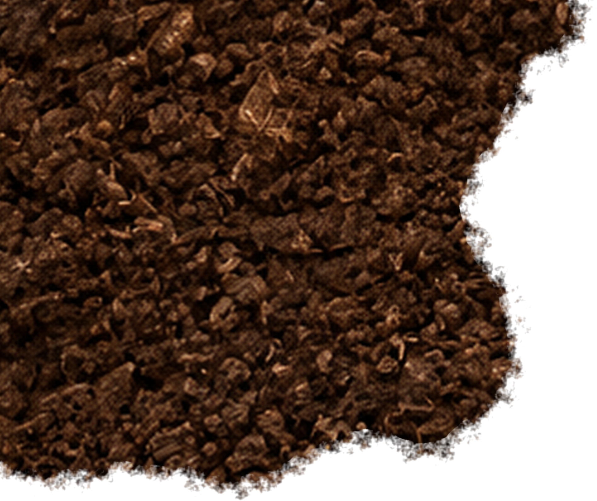
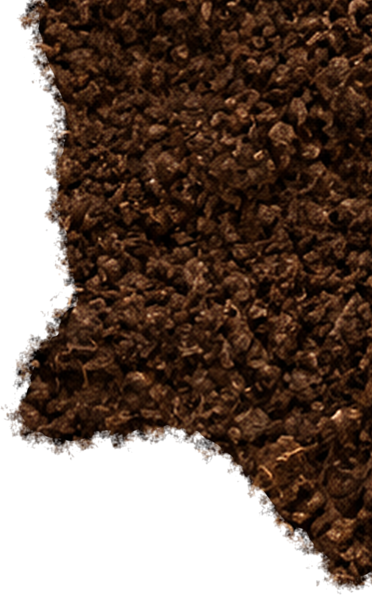
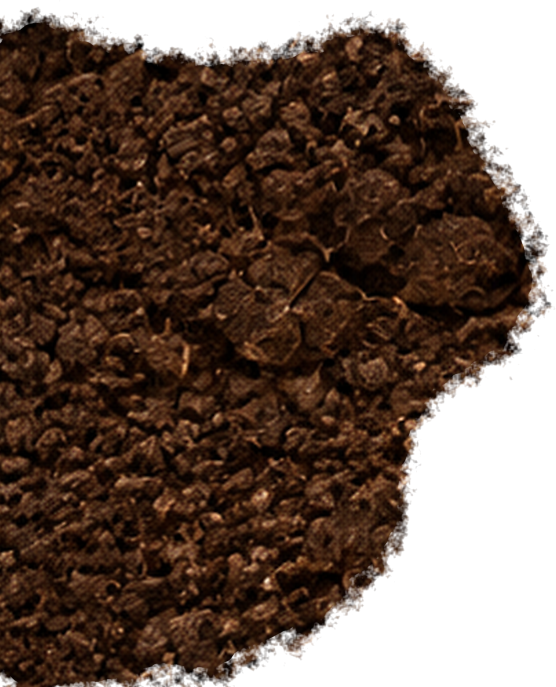
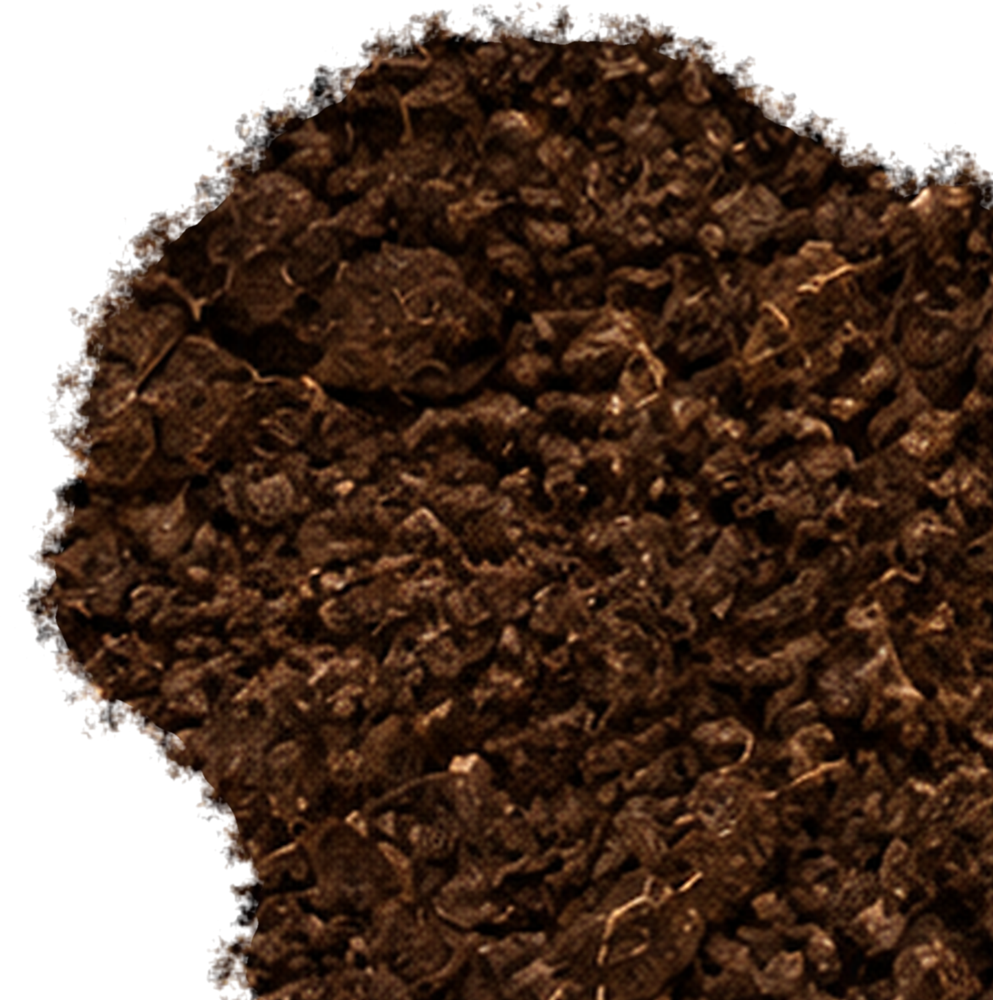
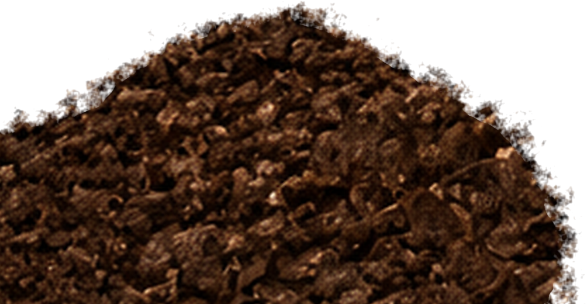

# Claude Design 実装指示：ツチノコファーム 土オーバーレイ

## 目的

5枚の背景透過PNGを組み合わせ、スクロール前は分割線のない一続きの土面として表示する。スクロールに合わせて各パーツを画面外へ移動し、下層の野菜写真とメッセージを露出させる。

## 絶対条件

- 基準キャンバスは `2400 × 3000px`、比率は `4:5`。
- PNGの透明部分・外周の土粒をトリミングしない。
- 各PNGは下表の位置と幅で配置する。`object-fit: cover` は使用しない。
- 土パーツ同士には約 `64px` の不透明な重なりと、各端に約 `140px` の土粒フェードが含まれている。
- 閉じた状態では全パーツを `transform: none` にする。同一キャンバス座標から切り出した画像なので、正しい座標で重ねれば分割線は出ない。
- 土レイヤーを個別に色調補正・明度補正・影付けしない。パーツごとの差が分割線として見えるため。

## レイヤー順

1. `z-index: 30` — ヘッダーとFV中央ロゴ（常に土より前面）
2. `z-index: 20` — 5枚の土パーツ（スクロールアニメーション対象）
3. `z-index: 10` — メッセージテキスト（スクロール前は土に隠す）
4. `z-index: 0` — みずみずしい野菜の背景画像

## 配置値

| Part | File | left | top | width | Scroll exit |
|---|---|---:|---:|---:|---|
| P1 | `soil-part-01-yellow-top-left.png` | 0.0000% | 0.0000% | 78.9167% | `translate(-115%, -115%)` |
| P2 | `soil-part-02-red-top-right.png` | 42.2917% | 0.0000% | 57.7083% | `translate(115%, -115%)` |
| P3 | `soil-part-03-green-left-middle.png` | 0.0000% | 33.4333% | 67.3333% | `translateX(-120%)` |
| P4 | `soil-part-04-blue-bottom-right.png` | 24.7083% | 39.3667% | 75.2917% | `translate(115%, 115%)` |
| P5 | `soil-part-05-orange-bottom-left.png` | 0.0000% | 71.1667% | 69.5000% | `translate(-115%, 115%)` |

`height` は `auto`。基準ステージ自体に `aspect-ratio: 4 / 5` を設定する。

## 推奨HTML

```html
<section class="farm-opening">
  
  <div class="farm-opening__message">...</div>
  <div class="soil-overlay" aria-hidden="true">
    
    
    
    
    
  </div>
  <header class="farm-opening__header">...</header>
  <div class="farm-opening__hero-logo">...</div>
</section>
```

## 推奨CSS

```css
.farm-opening {
  position: relative;
  aspect-ratio: 4 / 5;
  overflow: hidden;
}

.soil-overlay {
  position: absolute;
  inset: 0;
  z-index: 20;
  pointer-events: none;
}

.soil-part {
  position: absolute;
  height: auto;
  max-width: none;
  transform: none;
  transform-origin: center;
  will-change: transform;
}

.soil-part--1 { left: 0%; top: 0%; width: 78.9167%; z-index: 15; }
.soil-part--2 { left: 42.2917%; top: 0%; width: 57.7083%; z-index: 14; }
.soil-part--3 { left: 0%; top: 33.4333%; width: 67.3333%; z-index: 13; }
.soil-part--4 { left: 24.7083%; top: 39.3667%; width: 75.2917%; z-index: 12; }
.soil-part--5 { left: 0%; top: 71.1667%; width: 69.5000%; z-index: 11; }
```

## スクロールアニメーション

- スクロール進行度 `0 → 1` に合わせて `transform: none` から表の `Scroll exit` へ補間する。
- 目安区間はセクション先頭から `100vh`。
- 推奨イージングは `cubic-bezier(.16, 1, .3, 1)`。
- 5枚を同時に動かす。必要なら開始を最大 `0.04` ずつずらすが、閉じた状態の座標は変えない。
- `prefers-reduced-motion: reduce` ではアニメーションを無効化し、土パーツを最終位置で表示する。

## 完了確認

- 初期表示で白い隙間・暗い溝・影・色差がない。
- 画面幅を変更しても5枚の接合位置がずれない。
- 土粒フェードが透明背景ごと保持されている。
- ヘッダーとFVロゴは常に土より前面、メッセージと野菜写真は土より背面。
- スクロール後、各パーツが図解どおりの方向へ退避する。
